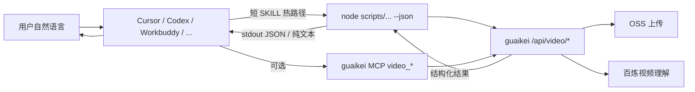

# video2text-skill 审查与优化跟进（合档）

- **审查日期**：2026-11-04
- **范围**：本仓库 JS Skill（`SKILL.md` + `scripts/**`）及其依赖的 `D:\Git\guaikei\server` 视频链路（`/api/video/*`、`app/video/upload.go`、`app/helper/aliyunvideo.go`、`model/video.go`）
- **目标用户**：面向更广泛大众的 AI Agent 使用者（Cursor / Codex / Claude Code / Workbuddy / Gemini CLI 等）
- **用法**：逐条处理后将 `[ ]` 改为 `[x]`，并在文末「跟进备注」补充 PR / 提交 / 日期
- **关联**：后端通用隐患见 `guaikei/server/TODO.md`（本档只摘与本 Skill 强相关项）

建议推进顺序：**P0 正确性与安全 → P1 Agent 可发现/可执行 → P2 体验与能力扩展 → P3 工程化与增长**（落地按 Phase 0→3）。

---

## 0. 现状一句话画像

本 Skill 是「CLI 薄客户端」：本地下载/上传 mp4 → 调 guaikei 预签名与任务 API → 轮询拿文案。核心智能在服务端（阿里云 IMM 取时长 + 百炼 `qwen3.7-plus` 视频理解）。对大众与 Agent 而言，**链路可用但偏「人读文档 + 人盯退出码」**；机器可解析契约、跨 Agent 分发路径、格式边界、安全归属校验仍是短板。

---

## 1. 问题全清单

### 1.1 P0 — 正确性 / 安全 / 计费信任（必须先修）

| ID | 层级 | 问题 | 位置 / 证据 | 影响 | 状态 |
|----|------|------|-------------|------|------|
| P0-1 | 后端 | **视频任务 UUID IDOR**：`GetVideoContent` 按 UUID 取任务后未校验 `upload.TokenId == 当前 token` | `guaikei/server/app/video/upload.go`；后端 TODO H9；`GetVideoByUuid` 甚至未 Select `token_id` | 知他人任务 ID 可触发解析/计费路径，或读到结果 | [ ] |
| P0-2 | 后端 | **Qwen HTTP 无超时**，失败 `return nil` 被 asynq 当成功 | `aliyunvideo.go` `http.DefaultClient.Do`；非 200 / 读流失败多处 `return nil`（对齐后端 TODO C5/H3） | Worker 永久挂死或静默丢任务；用户侧一直「处理中」直到轮询耗尽 exit 2 | [ ] |
| P0-3 | 后端 | **业务失败写成成功文案**：超 60s、余额不足、非视频类型等以 `status=2` + 中文说明写入 `content` | `aliyunvideo.go` 约 311–374 行；Skill 用 `text.includes("包月类TOKEN")` 等字符串兜底 | Agent 可能把错误当正文交给用户；弱模型更易漏判 | [ ] |
| P0-4 | 后端 | **包月次数在创建 parse 时预扣**，解析失败/超长拒绝不回滚 | `upload.go` GetVideoContent type=0 分支 `SET frequencyKey` | 用户「次数没了但没结果」；客诉与信任崩塌 | [ ] |
| P0-5 | 后端 | **presign DB 写入失败仅打日志仍返回 URL** | `UploadGetPresign` Create(&presign) 忽略 err | 审计/清理/归属链路断裂 | [ ] |
| P0-6 | Skill | **错误靠中文子串识别**：`包月类TOKEN` / `TOKEN余额可能不足` | `scripts/api/video.js` | 服务端文案一改即失效；英文 Agent 环境更难解释 | [ ] |
| P0-7 | Skill+后端 | **更换 prompt 必然重新计费**，Skill 虽提示但无硬闸 | SKILL.md §7；`VideoParse` 按 prompt 唯一 | Agent 自然改写用户 prompt（同义换词）会重复扣费；大众用户无感知 | [ ] |

### 1.2 P1 — Agent 发现、执行、输出契约（决定「能不能被广泛用」）

| ID | 层级 | 问题 | 位置 / 证据 | 影响 | 状态 |
|----|------|------|-------------|------|------|
| P1-1 | Skill 文档 | **`name` 与目录名不一致**：frontmatter `video2text-ai`，仓库目录 `video2text-skill` | `SKILL.md`；Cursor 规范要求 name 与父目录一致 | 部分 Agent 发现/校验失败 | [ ] |
| P1-2 | Skill 文档 | **SKILL.md 过重**：营销、计费表、FAQ 与执行协议混在同一热路径文件 | ~220 行 + 超长 description/tags | Claude/Codex 强调 concise；占上下文、淹没「怎么跑」 | [ ] |
| P1-3 | Skill 文档 | **description 关键词堆砌过长**（接近/触碰 1024 上限风险），中英混杂 | frontmatter description + tags 字段非标准 | 强模型检索被噪声干扰；弱模型可能过度触发或从不触发 | [ ] |
| P1-4 | 分发 | **无标准跨 Agent 安装路径**：未提供 `.agents/skills/` 布局说明；无 symlink/安装脚本 | 仓库根即 Skill | Cursor/Codex/Claude/Gemini/Workbuddy 发现路径不一，复制易漏 `scripts/` | [ ] |
| P1-5 | Skill 运行 | **必须在技能安装目录执行**；相对路径 `node scripts/...` | SKILL.md §3 | Agent 默认在用户项目 cwd 跑命令 → 找不到脚本 | [ ] |
| P1-6 | Skill 运行 | **无 `--json` / 机器可读 envelope**：stdout 纯文案，状态靠 exit code + stderr 中文 | `index.js` | GLM/DeepSeek/Kimi 等对 exit code 协议执行不稳；无法稳定链式调用 | [ ] |
| P1-7 | Skill 运行 | **`--id last` 绑定本机 `tmp/.last_task_id`** | `utils.js` | Cloud Agent、多会话、多用户、沙箱重建后「last」失效；不可移植 | [ ] |
| P1-8 | Skill 运行 | **无参数打印 help 却 exit 1**；有 `--help` 才 exit 0 | `index.js` 181–196 vs SKILL §7 | 与文档契约不一致，Agent 误判失败 | [ ] |
| P1-9 | Skill 运行 | **轮询预算固定 30 次 + 指数退避上限 30s**，长视频易 exit 2 | `constants.js`；`request.js` pollTaskResult | 弱 Agent 不会正确「同参续等」；强 Agent 也浪费多轮对话 | [ ] |
| P1-10 | 产品形态 | **无 MCP Tool 暴露 video2text**（guaikei MCP 有抖音/小红书等，无视频转写） | `guaikei/server/mcp/` | Cursor 等更偏好 MCP；纯 shell Skill 在部分环境权限/路径更差 | [ ] |
| P1-11 | Skill 文档 | **Agent 行为自由度过高**：自然语言→命令表有，但缺少「禁止事项」硬规则（勿改 prompt 同义、勿并发同任务、勿把 stderr 当结果） | SKILL.md | 计费翻倍、重复上传、结果污染 | [ ] |
| P1-12 | 工程 | **无 `.gitignore`**：`tmp/`、`.last_task_id`、pending 可能进仓 | 仓库根 | 泄露任务 ID / 脏文件；克隆后行为怪异 | [ ] |

### 1.3 P2 — 能力边界、体验、大众可用性

| ID | 层级 | 问题 | 位置 / 证据 | 影响 | 状态 |
|----|------|------|-------------|------|------|
| P2-1 | 产品 | **仅 mp4**；mov/webm/mkv/m4a/wav/aac 拒绝 | `validator.js`；后端 EqualFold `.mp4` | 手机相册、会议录音、剪映导出大量非 mp4 | [ ] |
| P2-2 | 产品 | **不支持平台分享页**；后端却具备抖音等解析能力 | SKILL「不要用」；MCP douyin_detail | 大众最常见输入是分享链，转化断裂 | [ ] |
| P2-3 | Skill | **不读系统代理** `HTTP(S)_PROXY` | SKILL §3；`https.request` 直连 | 国内企业网/海外 Agent 节点失败率高 | [ ] |
| P2-4 | Skill | **下载无全局超时**（Downloader timeout 默认 -1） | `download.js` / `helper.js` | 坏链或慢源可挂死进程 | [ ] |
| P2-5 | Skill | **仅扩展名校验，无 magic bytes / 大小上限文档** | `validator.js` | 伪 mp4、超大文件浪费带宽与 OSS | [ ] |
| P2-6 | Skill | **`clean.deleteExpire` 非真正 async**：`await clean.deleteExpire()` 立刻返回；且未跳过 `.pending_upload.json` | `clean.js`；`index.js` | 清理竞态；可能删掉续传元数据 | [ ] |
| P2-7 | Skill | **成功路径 stderr 仍打 Banner/营销感文案**；TOKEN 失败大段促销 | `utils.js` / `token.js` | 占 Agent 上下文；专业用户反感 | [ ] |
| P2-8 | 文档 | **README 承诺「视频 OCR」等能力**，与后端「ASR+OCR 融合进文案」边界模糊 | README 亮点 2 | 期望落差；Agent 可能宣称支持独立 OCR API | [ ] |
| P2-9 | 后端 | **模型写死 `qwen3.7-plus`**；无按 TOKEN/套餐选模型或降级 | `aliyunvideo.go` | 成本、可用性、效果无法分级；厂商变更即全站风险 | [ ] |
| P2-10 | 后端 | **强制模型以 JSON 返回再解析**；解析失败则把原始串当 content；`usage` 空指针风险 | `aliyunvideo.go` 592–629（`usage.TotalTokens`） | 偶发 panic / 脏输出；自定义任务字段丢失 | [ ] |
| P2-11 | 后端 | **包月 60s 限制在解析阶段才拒绝**，次数已扣 | 与 P0-4 叠加 | 应用侧无法在上传前友好拦截 | [ ] |
| P2-12 | Skill | **无批量 / 无队列并发控制原语**；仅文档说 shell 循环 | SKILL FAQ | 大众批量需求靠用户自研，易打爆 API | [ ] |
| P2-13 | Skill | **无预估费用 / 时长预览命令** | 缺失 | 按量用户不敢用长视频 | [ ] |
| P2-14 | 安全 | **客户端可被诱导下载任意 http(s) URL**（SSRF 面在用户侧，但仍有内网探测风险） | `download.js` | 在企业 Agent 场景需 allowlist / 阻断私网 | [ ] |

### 1.4 P3 — 工程化、可维护性、增长

| ID | 层级 | 问题 | 位置 / 证据 | 影响 | 状态 |
|----|------|------|-------------|------|------|
| P3-1 | 工程 | **零自动化测试** | 无 `*.test.js` | 回归靠人；退出码/轮询分类易坏 | [ ] |
| P3-2 | 工程 | **内嵌完整 Downloader ~1000 行**，无版本钉扎与上游同步策略 | `download.js` | 安全补丁难跟；审阅成本高 | [ ] |
| P3-3 | 工程 | **无 CI、无 skills-ref validate、无发布 checklist** | — | 跨 Agent 兼容性无守门 | [ ] |
| P3-4 | 文档 | **SKILL.md 与 README 双份真理**，已出现口径漂移风险 | 计费/OCR/销毁策略 | 维护成本 ×2 | [ ] |
| P3-5 | 观测 | **客户端无 request_id / 结构化错误码上报** | `request.js` 只打 errmsg | 客服只能要「stderr 最后 10 行」 | [ ] |
| P3-6 | 后端关联 | 日频控竞态、余额门禁未计 gift、软删 Token 仍可用等 | `guaikei/server/TODO.md` M3/M4/H10 | 间接伤害本 Skill 用户 | [ ] |
| P3-7 | 产品 | **开通路径偏人工微信**，无自助签发/沙箱试用 TOKEN | SKILL 联系方式 | 「普罗大众」转化漏斗窄 | [ ] |

---

## 2. 优化方向（宏观 → 可落地）

### 2.1 总战略：从「人读 CLI 文档」升级为「Agent 一等公民能力」

三条并行主线：

1. **契约硬化（Contract）**：机器可读输入/输出/错误码；计费与失败语义分离；禁止 Agent 无意重计费。
2. **触达面加宽（Surface）**：SKILL 精简热路径 + MCP Tool 双通道；跨 Agent 标准目录；可选本地格式转码。
3. **大众路径打通（Funnel）**：分享链/多格式/代理/自助 TOKEN/费用预估；失败可解释、可恢复。



### 2.2 Skill 层：怎么改（具体）

#### A. 文档分层（立刻可做，收益最大）

| 文件 | 职责 | 给谁看 |
|------|------|--------|
| `SKILL.md`（≤150 行目标） | When to use / When not / 精确命令 / 退出码 / 禁止事项 | 所有 Agent 热路径 |
| `reference/billing.md` | 计费细则 | 需要时再 Read |
| `reference/errors.md` | errcode 与用户话术 | 排错 |
| `README.md` | 人类营销与开通 | 网站/GitHub |

**description 改写原则**：第三人称；WHAT + WHEN；中英各保留高召回短句；去掉堆砌 tags 字段（非标准）。对 **GLM/Kimi/DeepSeek** 保留 8–12 个高频中文触发词即可；对 **Claude/GPT** 避免 50+ 同义词轰炸。

#### B. 机器可读 CLI（Agent 准确度核心）

增加：

```text
--json          # stdout 仅输出 JSON envelope
--quiet         # 抑制 banner；stderr 仅错误
--wait-seconds  # 覆盖本轮最大等待（替代死板 30 次）
--task-id-file  # 显式任务 ID 落盘路径（替代隐式 last）
--dry-run       # 仅校验本地文件/TOKEN 格式，不上传
```

建议 envelope：

```json
{
  "ok": true,
  "code": "OK",
  "exit_hint": 0,
  "task_id": "uuid",
  "text": "...",
  "meta": { "billed": false, "prompt_reused": true }
}
```

失败时：

```json
{
  "ok": false,
  "code": "STILL_PROCESSING|AUTH|QUOTA|UNSUPPORTED|NETWORK|REJECTED",
  "message": "人话",
  "retryable": true,
  "next": { "argv": ["--id", "<uuid>", "--prompt", "..."] }
}
```

**弱模型友好规则写进 SKILL（低自由度）**：

1. 永远加 `--json`（若已实现）。
2. `code=STILL_PROCESSING` → **原样参数**再跑，禁止改 prompt。
3. `ok=true` → 只把 `text` 给用户。
4. 禁止并发对同一 file 开两个进程。

#### C. 工作目录与安装

- 入口增加「自定位」：基于 `__dirname` 已部分满足；SKILL 改为写 **绝对路径模板** 或提供 `bin`：`npx video2text-ai` / `npm link`。
- 增加 `INSTALL.md`：复制到 `.agents/skills/video2text-ai/`（Codex/Cursor）、`.claude/skills/`、`.cursor/skills/`；强调整目录复制。
- 统一 `name` 与文件夹为同一标识（建议 `video2text-ai`）。

#### D. 健壮性小修

- `clean.deleteExpire` 改真正 Promise；跳过 `.last_task_id` / `.pending_upload.json`。
- 下载设默认超时（如 120s）与最大字节。
- 可选遵循 `HTTPS_PROXY`（`undici`/`proxy-agent` 或环境探测）。
- 无参与 `--help` 均 exit 0。
- 业务拒绝改为识别服务端 **稳定 errcode / `code` 字段**，字符串匹配仅作 fallback。
- 补 `.gitignore`：`tmp/`、`.env*`、`*.log`。

### 2.3 后端层：与 Skill 协同的改法

| 优先级 | 做什么 | 为何 |
|--------|--------|------|
| P0 | GetVideoContent 强制 Token 归属 | 安全底线 |
| P0 | 失败态用独立 `errcode`（如 20 超长、21 余额、22 非视频），**不要**把错误写进成功 `text` | Skill/Agent 可判定 |
| P0 | Qwen 请求 Timeout + Context；可重试错误 `return err` | 消灭僵尸任务 |
| P0 | 包月：成功落库后再 INCR；或预扣+失败回滚 | 计费公平 |
| P1 | 新增 `GET/POST /api/video/status` 返回阶段、时长、是否可解析、预估费用 | 上传前决策 |
| P1 | MCP：`video_transcribe` / `video_query`（长等待、TIMEOUT 同参续等，对齐现有 MCP 文风） | Cursor 原生体验 |
| P2 | 服务端或 Skill 侧 ffmpeg 转 mp4；分享链先走现有 douyin MCP 拿播放地址再转写 | 大众输入 |
| P2 | 模型路由可配置；JSON 解析失败重试一次「只抽字段」 | 效果与稳定性 |
| P2 | 同语义 prompt 归一化（hash 前 normalize 空白）降低误重计费（需产品确认） | 省钱 |

### 2.4 面向多模型的「准确使用」策略

| 模型族 | 特点 | 对本 Skill 的写法建议 |
|--------|------|------------------------|
| **Claude / GPT** | 遵循结构化协议强；厌冗长 | 短 SKILL + reference 外置；低自由度脚本；`--json` |
| **Gemini / Grok** | 工具调用积极，偶发跳步 | 步骤编号强制；「冲突规则」置顶；exit/code 表加粗短句 |
| **DeepSeek / GLM / Kimi** | 中文意图强；长链路轮询、隐式契约易丢 | 中文「失败→下一跳命令」直接可复制；示例多于抽象；避免只写 exit code 数字 |
| **Codex** | 偏 `.agents/skills`，执行环境干净 | 声明 `node` 版本；勿假设全局已安装依赖；给绝对技能根变量 |
| **Cursor** | Skill + Shell + 可读 MCP | **MCP + Skill 双暴露**；Cloud Agent 勿依赖 `tmp/last` |
| **Workbuddy 等** | 实现参差 | 只依赖：Node16+、HTTPS、单一入口脚本、JSON 输出 |

**统一原则**：把「聪明留给模型写 prompt 文案」，把「脆弱协议留给脚本」（上传、轮询、计费边界）。自由度：**协议低、文案高**。

### 2.5 产品增长（普罗大众）

1. **输入漏斗**：分享链 →（平台解析）→ 媒体文件 → 转写；本地非 mp4 → 自动转码。
2. **信任漏斗**：上传前显示「约 X 元 / 是否超 60s」；包月拒绝不扣次。
3. **开通漏斗**：官网自助试用 TOKEN（日限 1–2 次）降低微信门槛。
4. **Agent 漏斗**：一键「安装到 Cursor/Codex」说明 + 校验脚本 `node scripts/video2text/index.js --dry-run`。

---

## 3. 分阶段落地清单（勾选跟进）

### Phase 0（1–3 天）— 止血

- [ ] **P0-1** 后端：`GetVideoContent` 校验任务归属 Token（IDOR）
- [ ] **P0-2** 后端：千问请求超时；可重试错误勿 `return nil`
- [ ] **P0-3** 后端：业务失败用稳定 errcode，勿把错误当成功 `text`
- [ ] **P0-4** 后端：包月次数改为成功后再扣 / 失败回滚
- [ ] **P0-5** 后端：presign 落库失败勿返回 URL
- [ ] **P0-6** Skill：按 errcode/`code` 识别拒绝，字符串仅 fallback
- [ ] **P0-7** 产品+Skill：降低 Agent 改写 prompt 导致重计费（文档硬规则 + 后续归一化）
- [ ] **P1-8** 无参/`--help` 退出码与文档一致（建议均 0）
- [ ] **P1-12** 增加 `.gitignore`（`tmp/` 等）
- [ ] **P2-6** 修复 `clean.deleteExpire`（真 async + 跳过元数据文件）

### Phase 1（1–2 周）— Agent 就绪

- [ ] **P1-1** 统一 `name` 与技能目录名
- [ ] **P1-2 / P1-3** 精简 `SKILL.md`；计费/FAQ 外置 `reference/`
- [ ] **P1-4** 跨 Agent 安装说明（`.agents/skills` / `.cursor/skills` / `.claude/skills`）
- [ ] **P1-5** 任意 cwd 可执行（bin / 绝对路径自定位）
- [ ] **P1-6** `--json` / `--quiet` 机器可读输出
- [ ] **P1-7** 显式 `--task-id-file`，弱化隐式 `last`
- [ ] **P1-9** `--wait-seconds` 或自适应等待
- [ ] **P1-10** guaikei MCP 增加 `video_*` 工具
- [ ] **P1-11** SKILL 增加禁止事项（勿改 prompt 续等、勿并发、勿混用 stderr）

### Phase 2（2–6 周）— 大众能力

- [ ] **P2-1** 多格式或 ffmpeg 转 mp4
- [ ] **P2-2** 平台分享链编排（衔接现有抖音等能力）
- [ ] **P2-3** 支持系统代理
- [ ] **P2-4 / P2-5** 下载超时、大小上限、内容嗅探
- [ ] **P2-7** 收敛营销文案；Agent 模式安静输出
- [ ] **P2-8** README/能力边界与实现一致
- [ ] **P2-9 / P2-10** 模型可配置；加固 JSON/`usage` 解析
- [ ] **P2-11** 包月超长预检（与 P0-4 协同）
- [ ] **P2-12** 批量 / 并发控制原语（可选）
- [ ] **P2-13** 费用/时长预估 API + CLI
- [ ] **P2-14** 下载 URL 私网/协议防护

### Phase 3（持续）— 工程与增长

- [ ] **P3-1** 单测（args / 轮询分类 / validator / JSON envelope）
- [ ] **P3-2** Downloader 依赖策略
- [ ] **P3-3** CI + skills-ref validate
- [ ] **P3-4** README / SKILL 单一事实来源
- [ ] **P3-5** request_id / 结构化错误
- [ ] **P3-6** 跟进 `guaikei/server/TODO.md` 相关项（M3/M4/H10…）
- [ ] **P3-7** 自助试用 TOKEN

### 进度

| 阶段 | 项数 | 已完成 |
|------|------|--------|
| Phase 0 | 10 | 0 |
| Phase 1 | 9 | 0 |
| Phase 2 | 11 | 0 |
| Phase 3 | 7 | 0 |
| **合计** | **37** | **0** |

---

## 4. 验收标准（Definition of Done）

Agent 场景最少满足：

1. 在**任意 cwd** 用文档给出的一条命令可跑通（或 npm bin）。
2. 同一用户话术，Claude 与 DeepSeek 各 5 次试跑：**选对 Skill ≥80%**，**命令参数正确 ≥90%**。
3. 长视频处理中断后，Agent **无需人教** 能用 JSON/`next.argv` 续等，且 **不改 prompt**。
4. 伪造他人 `task_id` **无法**触发解析（IDOR 关闭）。
5. 余额不足/超 60s：**exit ≠ 0 或 `ok:false`**，且 stdout 不是「成功文案」。

---

## 5. 备忘：当前关键代码锚点

| 主题 | 路径 |
|------|------|
| Skill 入口 | `scripts/video2text/index.js` |
| 轮询与错误分类 | `scripts/utils/request.js` |
| 文案拉取与字符串拒识 | `scripts/api/video.js` |
| 预签名 / 任务 / 文案 API | `guaikei/server/app/video/upload.go` |
| 千问视频理解与扣费 | `guaikei/server/app/helper/aliyunvideo.go` |
| 后端总隐患表 | `guaikei/server/TODO.md` |

---

## 6. 变更记录

| 日期 | 说明 |
|------|------|
| 2026-11-04 | 初版审计存档（曾拆为 `docs/AUDIT-BACKLOG-*.md`） |
| 2026-11-04 | 审计全文合入本 `TODO.md`，以本文件为唯一跟进源 |

---

## 7. 跟进备注（处理时填写）

| ID | 处理人 | 日期 | PR/提交 | 备注 |
|----|--------|------|---------|------|
|  |  |  |  |  |
